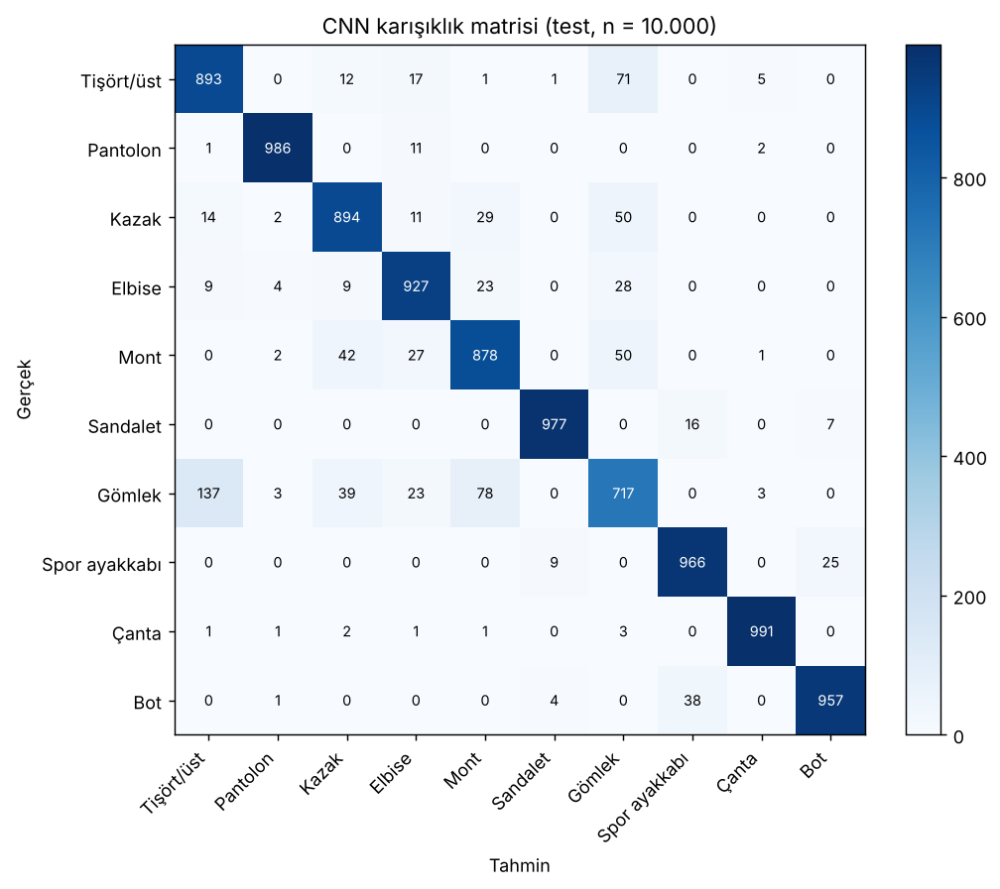

# Fashion-MNIST ile Kıyafet Görüntülerinin CNN ile Sınıflandırılması

[](https://colab.research.google.com/github/AbdullahRIHAWI/fashion-mnist-cnn/blob/main/fashion_mnist_cnn.ipynb)

28×28 gri tonlamalı ürün görüntülerini 10 kıyafet kategorisinden birine atayan bir CNN modeli. Model, bir e-ticaret platformuna yüklenen ürünlere otomatik kategori önermek ve emin olmadığı görüntüleri insan kontrolüne bırakmak için tasarlandı.

## Sonuçlar (test seti, 10.000 görüntü)

| Model | Parametre | Accuracy | Macro F1 |
|---|---|---|---|
| MLP (baseline) | 203.530 | 0,8851 | 0,8851 |
| **CNN** | 468.394 | **0,9186** | **0,9181** |

- En zayıf sınıf: Gömlek (F1 0,747); en sık karışıklık Gömlek → Tişört/üst (137 görüntü).
- Güven eşiği 0,90: görüntülerin %75,9'u otomatik etiketlenir, bu kısımda accuracy %98,72.



## İçerik

| Dosya | Açıklama |
|---|---|
| `fashion_mnist_cnn.ipynb` | Tüm adımlar ve çıktılar: veri keşfi, ön işleme, MLP ve CNN eğitimi, değerlendirme, hata analizi, güven eşiği analizi |
| `gorseller/` | Notebook'un ürettiği 8 grafik |
| `requirements.txt` | Gerekli kütüphaneler |

## Yöntem özeti

- **Ön işleme:** 0–1 normalizasyon, (28, 28, 1) kanal boyutu, 54.000 / 6.000 stratified eğitim/doğrulama ayrımı, eğitimde ±%8 kaydırma ve yatay çevirme.
- **CNN:** 2 × [Conv2D(32) + BatchNorm + ReLU] → MaxPool → Dropout(0,25) → 2 × [Conv2D(64) + BatchNorm + ReLU] → MaxPool → Dropout(0,25) → Dense(128) → Dropout(0,5) → Dense(10, softmax).
- **Eğitim:** Adam (0,001), sparse categorical crossentropy, batch 128, en fazla 20 epoch, EarlyStopping + ReduceLROnPlateau.

## Çalıştırma

Colab: yukarıdaki rozete tıkla → *Çalışma zamanı → Tümünü çalıştır*. GPU önerilir (*Çalışma zamanı türünü değiştir → T4 GPU*); CPU'da CNN eğitimi yaklaşık 20–30 dakika sürer.

Yerel:

```bash
pip install -r requirements.txt
jupyter notebook fashion_mnist_cnn.ipynb
```

## Veri seti

Fashion-MNIST — Zalando Research, MIT lisansı: https://github.com/zalandoresearch/fashion-mnist
Veri `tf.keras.datasets.fashion_mnist.load_data()` ile otomatik indirilir.
